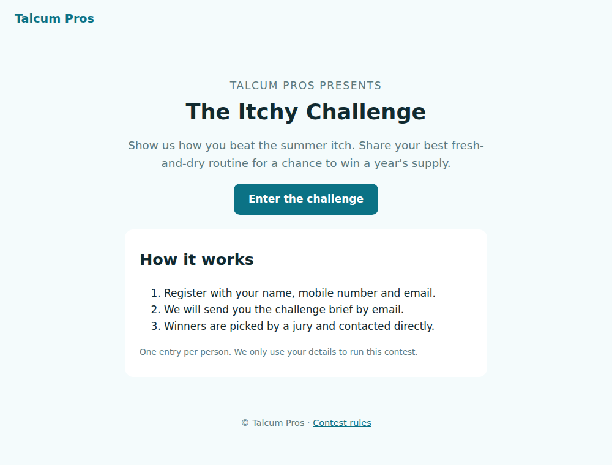
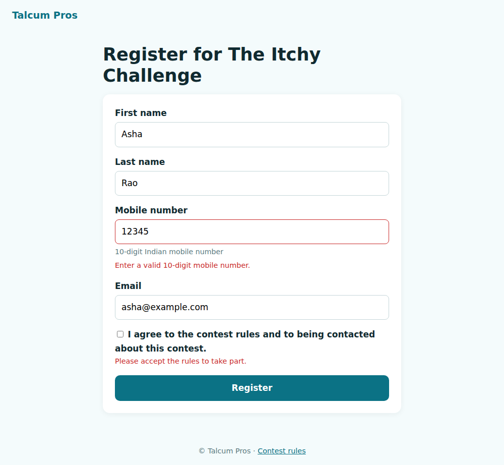

# Contest sign-up

[](https://github.com/kartikey13kaushiq/web_page/actions/workflows/ci.yml)
  

A landing page and registration flow for a brand contest ("The Itchy Challenge" by Talcum Pros).
It is small, but built the way a production marketing microsite should be: entries are validated
on the server, protected from bots and duplicates, stored safely, and exportable by the
marketing team.

| Landing | Registration with validation |
|---|---|
|  |  |

## What it does

- **Validation on the server**, not just in the browser (WTForms):
  - Names are letters only, including accented letters, hyphens and apostrophes.
  - Indian mobile numbers are accepted with or without `+91` or a leading `0`, and stored as
    10 digits.
  - The email format is checked.
  - Consent to the rules is required.
- **CSRF protection** on the form (Flask-WTF). A **honeypot field**, invisible to people,
  catches form-filling bots without a CAPTCHA.
- **One entry per person**: SQLite unique constraints on mobile number and case-insensitive
  email. A duplicate gets a friendly `409`.
- **Post/redirect/get**: refreshing the thank-you page never submits twice.
- **Admin export**: `GET /admin/entries.csv` with `Authorization: Bearer $ADMIN_TOKEN`.
  - The token is compared in constant time.
  - The endpoint returns 404 when the token is missing or wrong, and is disabled when no token
    is configured.
  - Cells starting with `= + - @` are neutralised, so a crafted name cannot run as a formula in
    Excel (CSV injection).
- **Hardening**: strict CSP, `nosniff`, `HttpOnly` and `SameSite` session cookies, a 16 KB
  request limit, and no debug server.

## Run it

```bash
pip install -e .
flask --app contest run                      # http://127.0.0.1:5000
```

```bash
docker build -t contest .
docker run -p 8000:8000 -v contest-data:/data \
  -e SECRET_KEY=$(openssl rand -hex 32) -e ADMIN_TOKEN=$(openssl rand -hex 24) contest
curl -H "Authorization: Bearer $ADMIN_TOKEN" localhost:8000/admin/entries.csv
```

| Variable | Default | |
|---|---|---|
| `SECRET_KEY` | random per start (with a warning) | Signs sessions and CSRF tokens; set it in production |
| `DATABASE_PATH` | `instance/entries.sqlite3` | SQLite file (`/data/...` in Docker) |
| `ADMIN_TOKEN` | unset (export disabled) | Bearer token for the CSV export |
| `CONTEST_NAME`, `BRAND_NAME` | The Itchy Challenge, Talcum Pros | Copy shown on the pages |

## Develop

```bash
pip install -e ".[dev]"
ruff check . && ruff format --check .
pytest          # 17 tests, 100% coverage
```

The tests cover:

- every validation rule and accepted mobile format;
- normalised storage;
- duplicates by email or mobile;
- the honeypot;
- output escaping;
- CSRF, both enforced and accepted with a valid token;
- export authorisation and CSV-injection neutralisation.

## License

[MIT](LICENSE)
